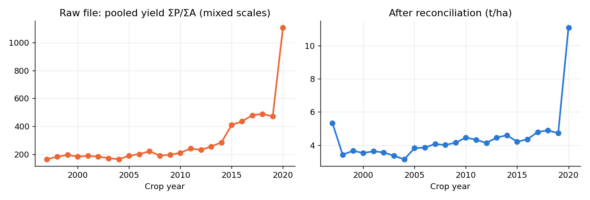
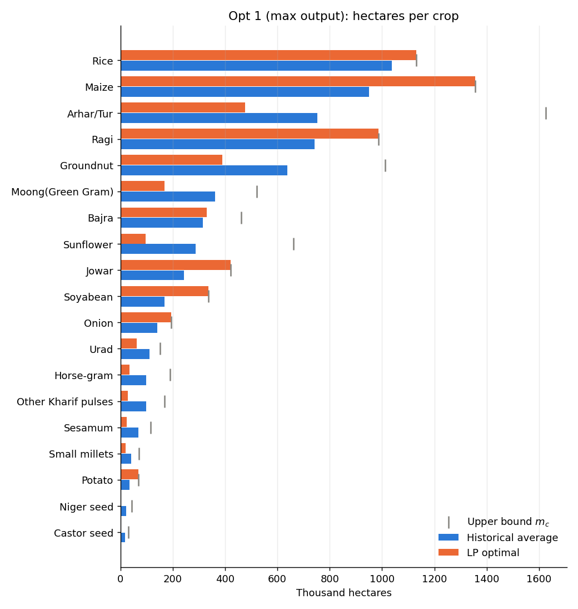
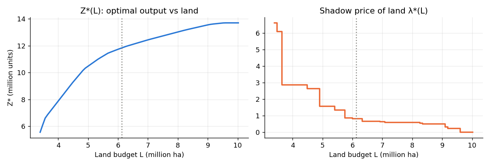
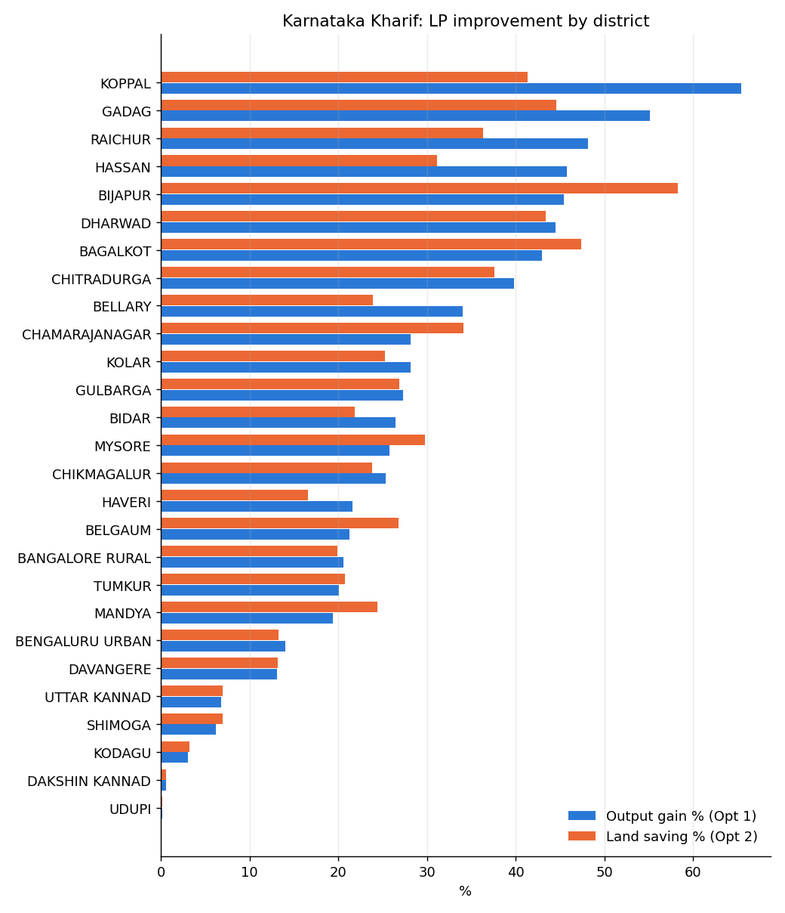

# Optimal Crop-Area Allocation for Agricultural Resource Planning
**A Linear Programming approach on Government of India district-level crop data**

Operations Research project. Authors: Nitin Krishna V (CB.SC.U4AIE23156), Vishal Suresh (CB.SC.U4AIE23160), Manogna Challa (CB.SC.U4AIE23175), Gaurav Mahesh (CB.SC.U4AIE23176). Amrita School of AI.

---

## Summary
Two LP models allocate fixed farmland across crops using only area, production and yield from the government record.

* **Opt 1** maximises output for a land budget L.
* **Opt 2** minimises the land needed to meet an output target D.

For **Karnataka, Kharif, 1998–2019** (19 crops):

| | Historical | LP optimal | Change |
|---|---:|---:|---:|
| Output on the same land (t) | 9,729,947 | 11,831,631 | **+21.6%** |
| Land for the same output (ha) | 6,125,458 | 4,663,668 | **−23.9%** |

With a realistic **±10%** limit on how much each crop's area can change, the gain is **+6.2% output**, or **5.0% less land**.

We also found that the public dataset contains a **duplicate copy of 212,373 records, inflated ×100**. It is fixed automatically before any modelling.

---

## 1. Problem and scope
Land is fixed and yields differ widely across crops, districts and years, yet allocation is decided by habit. **How should land be re-allocated to get the most from a fixed area?**

The scope is one state, one season and a multi-year average. The objective is output or land only: the data has no price or cost field, so profit is not invented. Only crops measured by weight are pooled into one model.

## 2. Data and cleaning
The source is the *District-wise, Season-wise Crop Production Statistics* (MoA&FW, data.gov.in): 575,879 rows covering 36 states, 730 districts, 128 crops and the years 1997–2020.

| Issue found | Action | Rows |
|---|---|---:|
| **Stacked duplicate source.** Rows 236,378 onward repeat earlier records with Production ×100 (99.4% of pairs) | Rescale ÷100, drop the twins | −212,373 |
| Production = 0 (mostly unreported) | Drop | −3,634 |
| Aggregate rows (Total foodgrain, Pulses total, Oilseeds total) | Drop, to avoid double counting | −1,133 |
| Spelling variants (Paddy, Dry Ginger, …) | Merge | 3,565 renamed |
| Count or bale units (Coconut in nuts; Cotton, Jute and Mesta in bales) | Exclude from pooling | — |

**Result:** 358,739 clean rows. Production is in tonnes; yields now match official figures (rice 1.8–2.8 t/ha). 1997 and 2020 have only partial coverage, so the analysis window is **1998–2019**.

## 3. Model
x_c = hectares allotted to crop c. y_c = mean yearly yield (ΣP/ΣA). a_c and m_c = the minimum and maximum yearly area.

| | Opt 1: maximise output | Opt 2: minimise land |
|---|---|---|
| Objective | max Σ y_c x_c | min Σ x_c |
| Binding constraint | Σ x_c ≤ L | Σ y_c x_c ≥ D |
| Bounds | a_c ≤ x_c ≤ m_c | a_c ≤ x_c ≤ m_c |
| Dual | λ* = output per extra ha | μ* = extra ha per unit of output |

By default, L and D are the historical land and output. The LP is a continuous knapsack:
1. every crop gets its minimum area a_c;
2. the remaining land is filled from the highest-yield crop downward, each crop up to m_c;
3. the crop where the land runs out is the single **basic crop**, and its yield equals λ*.

Both models are solved with **PuLP-CBC** and cross-checked with **SciPy-HiGHS**; the two solvers agree to within 10⁻⁹.

## 4. Results (Karnataka, Kharif, 1998–2019)
**Opt 1, at L = 6,125,458 ha:** Z* = 11.83 M t (+21.6%), λ* = 0.808 t/ha.
* **Expanded to their upper bound:** Potato, Onion, Maize, Rice, Ragi, Jowar, Soyabean.
* **Basic crop:** Bajra, whose yield is 0.81 t/ha.
* **Cut to their minimum:** low-yield crops such as pulses, oilseeds and millets.

**Opt 2, at D = 9,729,947 t:** minimum land is 4.66 M ha (−23.9%), μ* = 0.3806 ha/t, and Rice is the basic crop. Solving Opt 1 at that land gives λ* = 2.627, so 1/λ* = 0.3806 = μ*. This confirms the **duality** between the two models.

## 5. Sensitivity
* **More land:** Z*(L) is concave. λ* falls in steps (6.6 → 2.9 → 1.6 → 0.81 → 0) as each crop reaches its maximum area. This is diminishing returns to land.
* **Yield ranging:** the plan holds while expanded crops yield more than 0.81 t/ha. Soyabean is the most fragile: a fall of only 0.05 t/ha would remove it from the expanded set.
* **Yield shocks:** a uniform −30% shock only rescales output, and 0 ha are re-allocated. A −30% shock to Soyabean alone moves 288,406 ha. The plan is robust except for crops near the margin.
* **Flexibility:**

  | ±p% change allowed per crop | 5% | 10% | 20% | 30% | 50% |
  |---|---:|---:|---:|---:|---:|
  | Output gain | 3.1% | 6.2% | 12.5% | 18.7% | 31.2% |
  | Land saving | 2.5% | 5.0% | 10.0% | 15.0% | 25.0% |

  A ±10% band gives about 6%, in line with the +3.75–15% reported by Supriya et al. (2022).

## 6. Multi-district comparison
Both models were run separately for each of 27 districts. The median gain is **+25.8% output** or **24.4% less land**.
* **Largest gains** are in the diverse dry north: Koppal (+65%), Gadag (+55%), Raichur (+48%).
* **Smallest gains** are in the coastal districts that grow mainly rice: Udupi (+0.2%), Dakshina Kannada (+0.6%).
* The gain rises with the number of crops grown (r = 0.50). Maize is the crop most often expanded (16 of 27 districts).

## 7. Validation and tool
* **Synthetic data** ("Demo Pradesh", 1,664 rows) contains planted defects: duplicates, zero rows, aggregates, aliases, nut and bale units, and a drought year. All of them are caught.
* **Web app** (`python webapp/server.py`) has a simple tab-by-tab interface. Users can upload any CSV or Excel file, adjust the models with sliders, read plain-English explanations, run sensitivity analysis and compare districts. It runs on the same engine as this report, so the numbers are identical.

## 8. Limitations
* **Weight objective:** a tonne of onion counts the same as a tonne of pulses, so heavy crops are favoured.
* **Bounds:** the area bounds drive the result. Historical min/max bounds give +21.6%; ±10% bounds give +6.2%.
* **Not modelled:** prices, costs, soil, irrigation, labour, crop rotation and nutrition.

## 9. Conclusion
Using public government data alone, re-planning Karnataka's Kharif crop mix could give **+21.6% output, or 23.9% land savings**. Even a cautious ±10% re-plan gives about 6%. Next steps:
* use price- or nutrition-weighted objectives;
* add rotation and minimum-pulse constraints;
* build a stochastic LP using the yield variances already computed.

## References
1. H. A. Taha, *Operations Research: An Introduction*, 10th ed., Pearson, 2017.
2. S. Wankhade & H. Lunge, LP technique for optimum resource allocation in agricultural production, Akola, 2012.
3. F. Majeke et al., Linear programming approach: application in agriculture, 2020.
4. S. Supriya et al., Optimal crop plans using LP in Jayashankar Bhupalpally district, Telangana, 2022.
5. K. K. Paidipati & S. R. Padi, Optimal programming problems for crop planning, 2017.
6. X. Liang, LP approach in agricultural production-land allocation, Springer, 2023.
7. MoA&FW, GoI, *District-wise, Season-wise Crop Production Statistics (1997–2020-21)*, data.gov.in.

**Reproduce:** run `python run_case_study.py` to regenerate all numbers and figures. In the web app, open `http://127.0.0.1:8000/?load=gov&page=max`. Full tables are in `results/case_study_results.md`.
