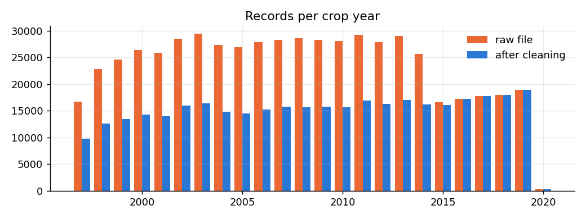
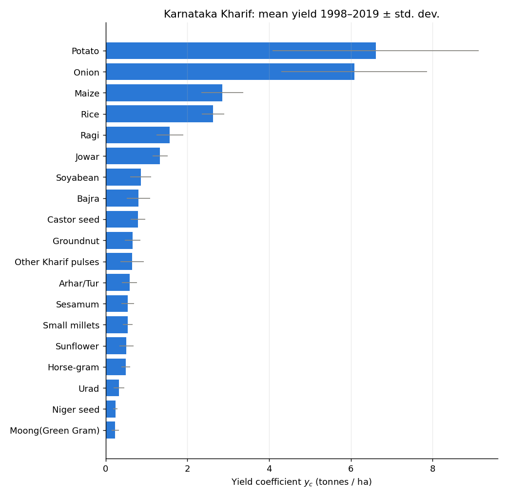
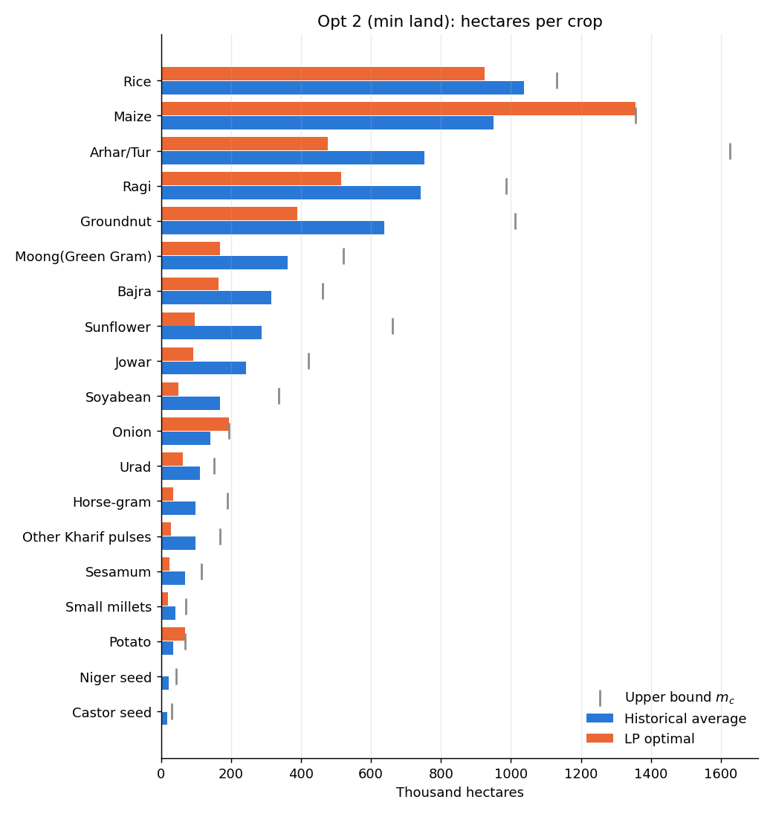
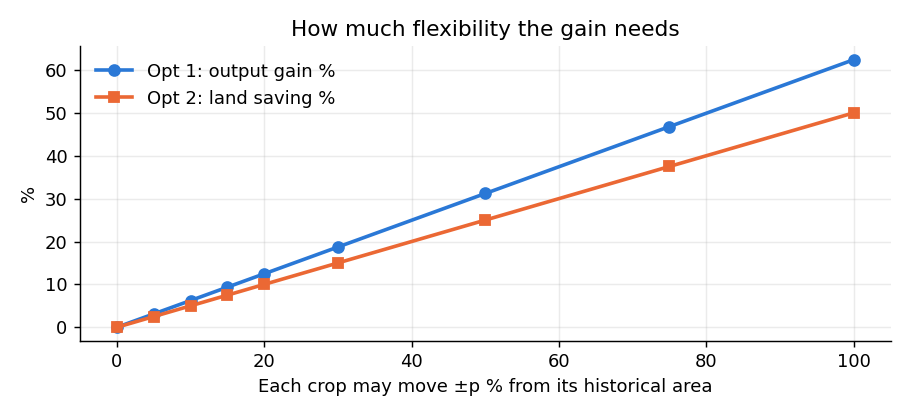

# Optimal Crop-Area Allocation for Agricultural Resource Planning
### A Linear Programming Approach using District-Level Crop Production Data (Government of India)

**Operations Research: Project Report (Reviews I–III)**
Nitin Krishna V (CB.SC.U4AIE23156) · Vishal Suresh (CB.SC.U4AIE23160) · Manogna Challa (CB.SC.U4AIE23175) · Gaurav Mahesh (CB.SC.U4AIE23176)
Department of Computer Science and Engineering (Artificial Intelligence), Amrita School of AI

---

## Contents
1. Problem Statement
2. Objectives & Scope
3. Literature Review & Research Gap
4. Dataset
5. Data Preparation and the Data Quirks Found
6. Formulation
7. Solution Method & Tools
8. Results — Case Study: Karnataka, Kharif, 1998–2019
9. Sensitivity Analysis
10. Multi-District Comparison
11. Interactive Dashboard
12. Validation on Synthetic Data
13. Discussion, Assumptions & Limitations
14. Conclusion & Future Work
15. References
Appendix — How to reproduce

---

## 1. Problem Statement

Land is fixed, and crops differ sharply in yield. Farmers tend to allocate hectares by habit rather than by comparing district-level yield records across crops.

* Yield per hectare varies widely across crops, districts and years.
* Land is limited, so one crop's gain is another crop's loss.
* Historical records exist at district–season–year granularity but are rarely used to re-plan the next season's allocation.

**Question:** using actual historical yield records, how should land be re-allocated across crops to get the most out of a fixed area?

## 2. Objectives & Scope

**Objectives (from Review I)**
* Use the dataset's own yield values (Yield = Production / Area) as LP coefficients.
* Formulate crop allocation as an LP in two directions: maximise output, and minimise land.
* Solve computationally with PuLP and SciPy `linprog`.
* Compare the optimal allocation with the actual historical allocation.
* *(Review III)* Add sensitivity analysis and a multi-district comparison.

**Scope**
* One state, one season, and a multi-year average.
* The dataset has no cost or price field, so the objective is output or land only, not profit.
* Only crops reported in the same production unit (weight) are pooled into one LP.

## 3. Literature Review & Research Gap

| Author, Year | Method | Contribution | Relevance |
|---|---|---|---|
| Wankhade & Lunge, 2012 | LP | Resource allocation, 10 crops, Akola district | LP works on Indian district-level crop data |
| Majeke et al., 2020 | LP | Land allocation, small-holder farm | LP plan beat the farmer's original plan |
| Supriya et al., 2022 | LP case study | Telangana crop plan, +3.75–15% returns | Realistic gains from LP crop planning |
| Paidipati & Padi, 2017 | Two LP models | Land allocation: cost-min & revenue-max | Motivates a primal/dual pair of objectives |
| Liang, 2023 | LP | Production–land allocation | Modern LP land-allocation formulation |

**Gap.** All the cited studies use a one-time survey of a single district and assume prices are known. None draws its coefficients from a multi-year, multi-district government production record.

**Our positioning.** We build the LP strictly from area, production and yield, using output-maximisation and land-minimisation only. Cost and profit are left out rather than approximated. The model is fully reproducible from a public dataset, and an interactive tool lets anyone re-run it on new data.

## 4. Dataset

| | |
|---|---|
| Dataset | District-wise, season-wise Crop Production Statistics, India |
| Source | Ministry of Agriculture & Farmers Welfare, GoI (data.gov.in), via Kaggle |
| Size | 575,879 rows × 8 columns, no missing values |
| Coverage | 36 states/UTs, 730 districts, 128 crop names, crop years 1997–2020 |
| Fields | `State_Name, District_Name, Crop_Year, Season, Crop, Area, Production, yield` |

The records cover six seasons: Kharif (228,520), Rabi (163,676), Whole Year (122,153), Summer (36,071), Winter (13,987) and Autumn (11,472). In every row, `yield` equals `Production / Area` exactly (verified: 0 mismatches).

> **Note on units.** The Review-I deck labels Production in quintals. After the reconciliation in §5.2, all-India pooled yields come out as Rice 2.0–2.8, Wheat 2.5–3.7 and Sugarcane ≈ 70 per hectare (Fig. 1). These values match the official data.gov.in figures in **tonnes per hectare**. All results below are therefore reported in tonnes and t/ha. The LP is unaffected, because the unit is only a common scale factor.

## 5. Data Preparation and the Data Quirks Found

The deck's lesson from earlier reviews was: *"don't leave a data quirk undiscovered until it breaks the model."* We applied that check systematically. `or_core.clean()` performs the steps below and logs each one.

| Step | Rows removed | Reason |
|---|---:|---|
| Missing Crop / Area / Production | 0 | Cannot form a coefficient |
| Exact duplicate rows | 0 | Would double-weight a year |
| **Stacked duplicate source reconciled** | **212,373** | Same record twice, once with Production × 100 (§5.2) |
| Area ≤ 0 | 0 | Yield undefined |
| Production = 0 | 3,634 | Mostly unreported; would drag averages toward 0 |
| Aggregate rows (Total foodgrain, Pulses total, Oilseeds total) | 1,133 | Sums of other rows, so pooling them double-counts |
| Crop-name variants merged | — (3,565 renamed) | Paddy→Rice, Dry Ginger→Dry ginger, "Other  Rabi pulses"→"Other Rabi pulses" |

**Result:** 575,879 rows → **358,739 clean rows**.

### 5.1 Production-unit consistency (deck slides 8–9, assumption 1)
Two independent tests decide which crops may be pooled:
1. **Known convention.** data.gov.in reports Coconut in **nuts**, Cotton (lint) and Kapas in **bales of 170 kg**, and Jute, Mesta and Sannhamp in **bales of 180 kg**. These are always excluded.
2. **Data-driven test.** A crop whose median yield is more than 250× (or less than 1/250 of) the pool's median is flagged as a scale outlier. This catches count-type crops in uploaded data that the convention list does not know about. The threshold can be changed in the app.

For Karnataka Kharif, this excludes **Cotton (lint)** and **Mesta**. The exclusions are confirmed from the data, not assumed: for example, Coconut's median "yield" is about 6,500 per ha, against about 2.6 for rice.

### 5.2 New finding: the file is two stacked copies of the same data
While checking yield trends we saw that the pooled yield roughly doubled in 2015 (Fig. 1, left). Looking closer:

* Rows **0–236,377** (crop years 1997–2015) form one block, and rows **236,378–575,878** (1997–2020) form a second block.
* **212,373 records appear in both blocks** with identical state, district, year, season, crop *and* area. In 99.4% of these pairs, the second copy's Production is **exactly 100×** the first copy's.
* The second block is the only source after 2014. This is why the raw pooled yield "jumps" in 2015, and why years before 2015 have about twice as many rows (Fig. 0).

If left untreated, every pre-2015 crop-year is counted twice, and yields that mix the two scales get averaged together. The LP coefficients would then be meaningless.

**Fix (`reconcile_stacked_sources`).** The function:
1. detects record pairs that share all six key fields;
2. takes the modal Production ratio, snapped to a power of ten (k = 100);
3. checks that the pairs split cleanly by row position;
4. divides Production by k for every row in the second block;
5. keeps one row per pair.

After the fix, the pooled yield series is smooth from 1998 to 2019 (Fig. 1, right). The detector is generic, so it also protects any uploaded file with the same defect.

1997 and 2020 remain anomalous because they are **partial-coverage years**: 2020 has only 319 rows. The dashboard therefore defaults to the window of years with full coverage, which here is **1998–2019**.




### 5.3 Coefficient construction (deck slide 11)
For each crop c in the scope (state, season, years), rows are summed to crop-year level across districts. Then:

* **y_c** = mean over years of (ΣProduction / ΣArea). This is the deck's "averaged over available years". The app also offers the median and an area-weighted variant (ΣP/ΣA over all years).
* **a_c** = the minimum yearly area, and **m_c** = the maximum yearly area (historical bounds, deck slide 12).
* **Historical allocation** = the average yearly area. **Historical output** = Σ_c y_c × average area.
* Crops observed in fewer than ⅔ of the years are dropped, because their averages are unstable.

## 6. Formulation

**Decision variables:** x_c = hectares allotted to crop c.

**Optimization 1: maximise agricultural output (deck slides 11–12)**

$$\max\ Z=\sum_c y_c x_c\quad \text{s.t.}\quad \sum_c x_c \le L,\qquad a_c\le x_c\le m_c\ \ \forall c,\qquad x_c\ge 0$$

**Optimization 2: minimise land for a production target (deck slide 13)**

$$\min\ \sum_c x_c\quad \text{s.t.}\quad \sum_c y_c x_c \ge D,\qquad a_c\le x_c\le m_c\ \ \forall c,\qquad x_c\ge 0$$

Defaults: L is the historical average total area of the pooled crops. D is the historical output.

**Structure of the solution.** With a single coupling constraint plus box bounds, Opt 1 is a *continuous knapsack*:
1. give every crop its minimum a_c;
2. sort the crops by y_c;
3. fill the remaining land from the highest-yield crop downwards, each up to m_c.

The crop at which the land runs out is the **single basic variable**, and its yield equals the land shadow price λ*. Crops with y_c > λ* end at m_c, and crops with y_c < λ* end at a_c. Opt 2 has the same structure with the roles of land and output swapped.

From LP duality, solving Opt 1 with L equal to Opt 2's minimum land returns Z* = D, and **μ\* = 1/λ\***. We verify this numerically (§8.3).

## 7. Solution Method & Tools

| Layer | Tool |
|---|---|
| Data & statistics | pandas, NumPy |
| Optimisation | **PuLP 3.3 (CBC)**, the primary solver, which gives the duals (`.pi`) and reduced costs (`.dj`). **SciPy 1.17 `linprog` (HiGHS)** is an independent cross-check and the fast solver for sweeps. |
| Visualisation | Plotly (interactive), Matplotlib (report figures) |
| Interface | **CropLP** web app: FastAPI + uvicorn backend, hand-built HTML/CSS/JS frontend with Plotly.js (fully offline) |

Every LP in the app is solved by both solvers, and their objectives and duals are displayed side by side. In all runs the relative difference is below 1e-9.

## 8. Results — Case Study: Karnataka, Kharif, 1998–2019

Karnataka Kharif was chosen as the main case study because it is a large, diverse rain-fed season: **19 poolable crops** have ≥ 15 years of data each. Any other state or season can be run in the dashboard.

### 8.1 Coefficients

| Crop | y_c (t/ha) | sd | a_c (ha) | m_c (ha) | Hist. area (ha) |
|---|---:|---:|---:|---:|---:|
| Potato | 6.61 | 2.52 | 17,797 | 67,728 | 34,386 |
| Onion | 6.08 | 1.79 | 67,739 | 193,156 | 141,525 |
| Maize | 2.86 | 0.51 | 450,472 | 1,355,321 | 950,337 |
| Rice | 2.63 | 0.28 | 737,547 | 1,129,883 | 1,037,666 |
| Ragi | 1.57 | 0.33 | 514,756 | 986,173 | 741,457 |
| Jowar | 1.33 | 0.18 | 92,465 | 420,808 | 242,460 |
| Soyabean | 0.86 | 0.26 | 48,444 | 336,850 | 168,253 |
| Bajra | 0.81 | 0.29 | 163,108 | 461,048 | 314,335 |
| Castor seed | 0.79 | 0.18 | 2,650 | 30,366 | 16,778 |
| Groundnut | 0.66 | 0.19 | 389,994 | 1,012,577 | 638,593 |
| Other Kharif pulses | 0.64 | 0.29 | 28,375 | 169,312 | 98,554 |
| Arhar/Tur | 0.58 | 0.18 | 475,396 | 1,626,389 | 752,171 |
| Sesamum | 0.54 | 0.15 | 24,776 | 115,250 | 67,684 |
| Small millets | 0.54 | 0.12 | 19,229 | 71,447 | 40,699 |
| Sunflower | 0.51 | 0.17 | 95,442 | 661,178 | 287,392 |
| Horse-gram | 0.49 | 0.10 | 35,541 | 189,486 | 99,059 |
| Urad | 0.33 | 0.13 | 63,176 | 152,106 | 110,524 |
| Niger seed | 0.24 | 0.06 | 993 | 44,000 | 22,591 |
| Moong (Green Gram) | 0.23 | 0.09 | 169,271 | 520,630 | 360,994 |



### 8.2 Optimization 1: maximise output at L = 6,125,458 ha (historical)

| | Historical | LP optimal | Change |
|---|---:|---:|---:|
| Total output (t) | 9,729,947 | **11,831,631** | **+21.60%** |
| Land used (ha) | 6,125,458 | 6,125,458 | 0 |
| Shadow price of land λ* | — | **0.808 t/ha** | — |
| PuLP vs SciPy objective | — | 11,831,630.89 vs 11,831,630.89 | identical |

* **Expanded to their upper bound:** Potato (+97%), Onion (+36%), Maize (+43%), Rice (+9%), Ragi (+33%), Jowar (+74%), Soyabean (+100%).
* **Basic (marginal) crop:** **Bajra**, with 330,696 ha (+5%). Its yield of 0.81 t/ha *is* λ*.
* **Cut to their historical minimum:** Groundnut, Arhar/Tur, Sunflower, Moong, Urad, Sesamum, Horse-gram, Niger seed, Small millets, Castor seed and Other Kharif pulses, all with yield below 0.81 t/ha.
* **Reading λ\*:** one more hectare of Kharif land in Karnataka would add about 0.81 t of output, because it would go to Bajra. The reduced cost of each crop at its lower bound is y_c − λ* (for example, Groundnut −0.15). This is how much its yield would have to rise before the LP would give it more land.


### 8.3 Optimization 2: minimise land for D = 9,729,947 t (historical output)

| | Historical | LP optimal | Change |
|---|---:|---:|---:|
| Land needed (ha) | 6,125,458 | **4,663,668** | **−1,461,790 ha (−23.86%)** |
| Output (t) | 9,729,947 | 9,729,947 | 0 |
| Shadow price of target μ* | — | **0.3806 ha/t** | — |

* Potato, Onion and Maize go to m_c. **Rice is the basic crop** (923,847 ha), and every other crop drops to a_c.
* **Duality check:** solving Opt 1 with L = 4,663,668 ha returns Z* = D, with λ* = 2.6273 = y_Rice. Then 1/λ* = 0.380616 = μ*, exactly as theory predicts. The two models describe the **same efficient frontier read in opposite directions**, which is the primal/dual pairing proposed on deck slide 13.



## 9. Sensitivity Analysis

### 9.1 Parametric land budget
Z*(L) is **piecewise-linear and concave**. Its slope (λ*) steps down each time the marginal crop reaches its upper bound: from 6.6 (Potato) through 2.9 (Maize), 1.6 (Ragi) and 0.81 (Bajra at the historical L), down to 0 once every crop is at m_c. This is diminishing marginal returns to land, read directly from the dual.


### 9.2 Yield-coefficient ranging (Opt 1 at the historical L, λ* = 0.808)
* **Crops at m_c** (Potato … Soyabean) keep the same optimal plan as long as their yield stays above 0.81 t/ha. Soyabean is the most fragile of these: a fall of only **0.05 t/ha** would push it off its upper bound.
* **Bajra (basic)** stays the marginal crop while its yield is in [0.79, 0.86], that is, between Castor seed and Soyabean.
* **Crops at a_c** would need large yield increases to earn more land: +0.15 t/ha for Groundnut, and +0.58 for Moong.

### 9.3 Weather / yield-shock scenarios

| Scenario | Shock | Change in Z* | Hectares re-allocated |
|---|---:|---:|---:|
| All crops | −30% / −15% / +15% | −30% / −15% / +15% | 0 |
| Maize only | −30% | −9.8% | 0 |
| Rice only | −30% | −7.5% | 0 |
| Soyabean only | −30% | −0.4% | **288,406** |

A uniform shock only rescales Z*, so the *plan* is robust to a generally bad or good year. A crop-specific shock changes the plan only for crops near the margin, such as Soyabean, which the ranging in §9.2 predicted.

### 9.4 How much flexibility does the gain need?
The deck's historical min/max bounds are wide: some crops' areas varied 3–4× over 22 years. To test realism, we limited every crop to ±p% of its historical area:

| Allowed change ±p | 5% | 10% | 20% | 30% | 50% | 100% |
|---|---:|---:|---:|---:|---:|---:|
| Opt 1 output gain | 3.1% | 6.2% | 12.5% | 18.7% | 31.2% | 62.4% |
| Opt 2 land saving | 2.5% | 5.0% | 10.0% | 15.0% | 25.0% | 50.0% |

The gain grows almost linearly with flexibility. Even a modest ±10% re-planning gives about **+6% output** or about **5% land saved**, in line with the +3.75–15% reported by Supriya et al. (2022). The +21.6% headline figure needs the full historical swing.



## 10. Multi-District Comparison (Karnataka, Kharif, 1998–2019)

Both LPs were solved independently for **27 districts**, each with its own coefficients, bounds, L and D.

* **Median output gain: 25.8%.** **Median land saving: 24.4%.**
* The largest potential is in the northern dry districts: **Koppal (+65%), Gadag (+55%), Raichur (+48%)**. These have a high-yield crop (Onion, Maize) with large historical swings in area.
* The smallest potential is in the coastal districts: **Udupi (+0.2%), Dakshina Kannada (+0.6%)**. These grow essentially only Rice and Maize, so there is little to re-allocate.
* Maize is the crop the LP expands most often (16 of 27 districts), followed by Rice (6).
* The gain is positively correlated with the number of crops grown (r = 0.50). Crop diversity is what gives the LP room to improve.


## 11. Interactive Dashboard

`python webapp/server.py` (or `run_app.bat`) starts **CropLP** at http://127.0.0.1:8000. It is a guided, eight-step web interface (see README §3). The FastAPI backend wraps `or_core.py` unchanged, so every number shown is identical to this report. Users can:

* **upload any CSV or Excel file** by drag-and-drop, with auto-detected and editable column mapping, and with Yield computed if it is missing;
* toggle each cleaning rule, including the stacked-source fix, and see its effect immediately;
* choose the state, season, districts and year window from a sticky scope bar, and set the yield-averaging method, bound type (historical or ±band) and unit-check threshold in a settings drawer;
* switch individual crops on and off; each carries a unit badge such as "bales of 170 kg";
* see all slide-10 exploratory plots, each with auto-generated insight cards;
* solve both LPs with sliders and presets, read a **plain-English explanation** of the plan, inspect the printed LP, compare PuLP with HiGHS, and download the plans as CSV;
* explore sensitivity (parametric curves, ranging, weather-shock simulator, flexibility sweep) and the multi-district comparison;
* hover over technical terms for definitions, switch between light and dark themes, and use it at phone width.

A legacy Streamlit prototype (`app.py`) is kept for reference.

## 12. Validation on Synthetic Data

`generate_synthetic_data.py` creates **"Demo Pradesh"**: 6 districts, 3 seasons, 21 crops and 2008–2019, with district-specific comparative advantage, a yield trend, weather noise and a **drought in 2015 (Kharif)**. It deliberately plants every quirk the pipeline must catch:

| Planted quirk | Detected by | Result |
|---|---|---|
| 8 exact duplicate rows | cleaning | 8 removed ✔ |
| 25 zero-production rows | cleaning | 25 removed ✔ |
| 144 "Total foodgrain" aggregate rows | cleaning | 144 removed ✔ |
| "Paddy" spelling for Rice | alias merge | merged ✔ |
| Coconut in nuts, Cotton in bales | unit check | excluded ✔ |
| 2015 drought | quirk detector / shock | flagged as a +41% rebound in 2016 ✔ |

On the synthetic Kharif scope, Opt 1 gives +5.15% output (λ* = 16.81) and Opt 2 saves 4.74% land. PuLP and SciPy agree exactly.

A second file, `synthetic_minimal_farm.csv`, has only `Crop, Year, Area_ha, Production_q`. The app maps these columns automatically and reproduces the RIVERBEND district result (+12.07%) from the full file. This shows that the pipeline is consistent across input formats.

## 13. Discussion, Assumptions & Limitations

1. **Production units must match.** Count and bale crops are excluded, as confirmed from the data. Within the weight pool, a tonne of onion and a tonne of pulses count equally. **The weight objective favours heavy, high-moisture crops** such as Potato, Onion and Maize, and penalises protein-dense pulses. This is the most important caveat when reading the results.
2. **Historical averages.** Yields are averages, and year-to-year weather is not in the base LP. §9.3 shows that the plan is robust to uniform shocks but sensitive at the margin.
3. **Output, not profit.** The dataset has no cost or price field, so none is invented.
4. **Not modelled:** soil quality, irrigation, labour, crop rotation, price and demand effects, and food-security or nutrition requirements. Cutting pulses to their historical minimum may be agronomically undesirable because pulses fix nitrogen for rotation.
5. **The bounds drive the answer.** In a knapsack-structured LP the bounds a_c and m_c decide how far the plan moves. Historical min/max bounds produce optimistic gains (+21.6%), while ±10% bands give +6%. Both are reported.
6. **Data quality.** The stacked-source defect (§5.2) would have silently corrupted every coefficient. It is now detected and fixed automatically, which validates the deck's insistence on checking data quirks before modelling.

## 14. Conclusion & Future Work

Using only area, production and yield from the government record, both LPs from Review I were built, solved and validated for Karnataka Kharif 1998–2019:

* **Opt 1:** the same land could have produced **21.6% more** output.
* **Opt 2:** the same output could have been grown on **23.9% less land**.
* The two models are linked exactly by duality (μ* = 1/λ*).
* Gains are highest in diverse, dry northern districts and close to zero on the rice-dominated coast.
* Realistic ±10% re-planning still gives about 6%, which matches published LP crop-planning studies.

**Future work:**
* Weight the objective by price or nutrition (calories or protein) when such data is joined, which makes it a profit or nutrition LP.
* Add rotation and minimum-pulse constraints.
* Use stochastic or robust LP with the yield standard deviations already computed.
* Run a district-level joint LP with a state-wide land or food-security constraint.

## 15. References
1. Taha, H. A., *Operations Research: An Introduction*, 10th ed., Pearson, 2017.
2. Wankhade, S. & Lunge, H., "LP Technique for Optimum Resource Allocation in Agricultural Production," Akola District, Maharashtra, 2012.
3. Majeke, F. et al., "Linear Programming Approach – Application in Agriculture," 2020.
4. Supriya, S. et al., "Optimal Crop Plans Using LP in Jayashankar Bhupalpally District, Telangana," 2022.
5. Paidipati, K. K. & Padi, S. R., "Optimal Programming Problems for Crop Planning and Agricultural Resource Management," 2017.
6. Liang, X., "LP Approach in Agricultural Production-Land Allocation," Springer, 2023.
7. Ministry of Agriculture & Farmers Welfare, GoI, *District-wise, Season-wise Crop Production Statistics (1997–2020-21)*, data.gov.in, via Kaggle.

---

## Appendix — How to reproduce

```bash
pip install -r requirements.txt
python generate_synthetic_data.py     # sample_data/*.csv
python run_case_study.py              # results/*.csv, *.png, case_study_results.md (all numbers in this report)
python webapp/server.py               # CropLP web app (http://127.0.0.1:8000)
```

To check the case study in the app, open http://127.0.0.1:8000/?load=gov&page=max, or use these settings: **Government of India data** · State **Karnataka** · Season **Kharif** · years **1998–2019** · y_c = **Mean** · bounds = **Historical min/max** · min. years **15**. These are the app defaults when the Government dataset is loaded.
